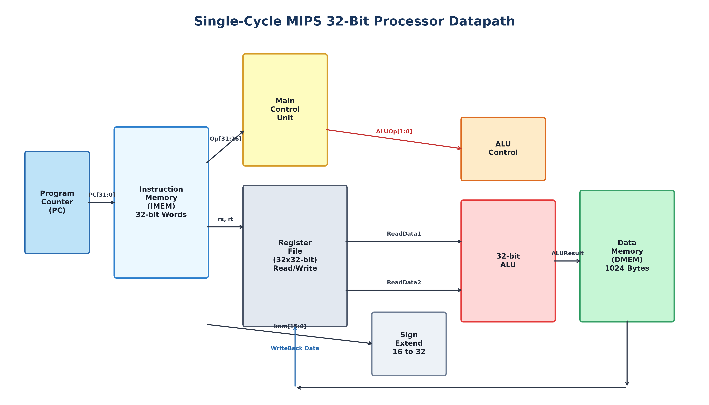

# Single-Cycle MIPS Processor with Memory Interface


-purple.svg)

A complete, fully verified, synthesizable 32-bit single-cycle MIPS processor with a Harvard memory subsystem implemented in Verilog HDL. Developed as a 5-member university group project for Phase I evaluation (30% weight).

---

## Architecture Overview

The processor implements a classic 32-bit single-cycle datapath executing one instruction per clock cycle ($CPI = 1$). To avoid structural memory hazards during single-cycle operation, the design utilizes a Harvard memory interface separating Instruction Memory (IMEM) and Data Memory (DMEM).



### Key Features
- **32-Bit Datapath:** Uniform 32-bit data buses, registers, ALU, and memory interfaces.
- **32 General-Purpose Registers:** Register `$zero` (`$0`) is hardwired to `32'h00000000` in hardware.
- **Program Counter (PC):** 32-bit byte-addressed PC with synchronous reset and branch/jump target resolution.
- **Harvard Memory Interface:**
  - **Instruction Memory:** 256 words (1024 bytes) combinational ROM supporting machine-code loading from `.hex` files.
  - **Data Memory:** 256 words (1024 bytes) RAM supporting word-aligned addressing with combinational read and synchronous write.
- **Synthesizable Verilog 2001:** Zero latches, no multi-driven nets, and verified clean compilation under Icarus Verilog.
- **100% Automated Self-Checking Verification:** 57 assertions executed across 5 testbenches with 0 failures.

---

## Supported Instruction Set Architecture (ISA)

The processor supports 10 core MIPS instructions:

| Instruction | Type | Opcode | Funct | Semantics |
|-------------|:----:|:------:|:-----:|-----------|
| **ADD** | R | `000000` | `100000` | $R[rd] \leftarrow R[rs] + R[rt]$ |
| **SUB** | R | `000000` | `100010` | $R[rd] \leftarrow R[rs] - R[rt]$ |
| **AND** | R | `000000` | `100100` | $R[rd] \leftarrow R[rs] \ \& \ R[rt]$ |
| **OR** | R | `000000` | `100101` | $R[rd] \leftarrow R[rs] \ \| \ R[rt]$ |
| **SLT** | R | `000000` | `101010` | $R[rd] \leftarrow (R[rs] <_{\text{signed}} R[rt]) \ ? \ 1 : 0$ |
| **ADDI** | I | `001000` | — | $R[rt] \leftarrow R[rs] + \text{SignExt}(imm)$ |
| **LW** | I | `100011` | — | $R[rt] \leftarrow \text{Mem}[R[rs] + \text{SignExt}(offset)]$ |
| **SW** | I | `101011` | — | $\text{Mem}[R[rs] + \text{SignExt}(offset)] \leftarrow R[rt]$ |
| **BEQ** | I | `000100` | — | $\text{if } R[rs] == R[rt] \implies \text{PC} \leftarrow (\text{PC}+4) + (\text{SignExt}(imm) \ll 2)$ |
| **J** | J | `000010` | — | $\text{PC} \leftarrow \{(\text{PC}+4)[31:28], target[25:0], 2'b00\}$ |

---

## Verilog RTL Hierarchy

```
top_module.v (System Wrapper)
 ├── instruction_memory.v (256 Words / 1024 Bytes ROM)
 ├── data_memory.v        (256 Words / 1024 Bytes RAM)
 └── mips_cpu.v           (CPU Core Datapath & Control)
      ├── program_counter.v (PC Register with Reset)
      ├── control_unit.v    (6-bit Opcode Decoder)
      ├── register_file.v   (32x32-bit Dual-Read Synchronous Write)
      ├── sign_extend.v     (16-to-32 bit Sign Extender)
      ├── alu_control.v     (ALU Op & Funct Decoder)
      └── alu.v             (32-bit ALU with Zero Detection)
```

---

## Verification & Benchmark Results

### 1. Verification Summary Table
| Testbench | Module Under Test | Tests Executed | Tests Passed | Status |
|:---|:---|:---:|:---:|:---:|
| `testbench/tb_alu.v` | 32-bit ALU | 16 | 16 | **PASS** |
| `testbench/tb_control_unit.v` | Main Control Unit | 7 | 7 | **PASS** |
| `testbench/tb_register_file.v` | Register File | 5 | 5 | **PASS** |
| `testbench/tb_data_memory.v` | Data Memory | 5 | 5 | **PASS** |
| `testbench/tb_mips_cpu.v` | CPU Core + System Integration | 24 | 24 | **PASS** |
| **Total Assertions** | — | **57** | **57** | **100.0%** |

### 2. Benchmark Programs Executed

#### Program 1: Array Summation (Mandatory)
- **File:** `programs/array_sum.asm`, `programs/array_sum.hex`
- **Input Array:** `[10, 20, 30, 40]` preloaded into Data Memory.
- **Demonstrates:** `LW`, `ADD`, `ADDI`, `BEQ`, `SW`, `J`.
- **Expected Sum:** `100` (`0x00000064`).
- **Observed Simulation Output:**
  ```text
  [PASS] Array Sum Program: Mem[16] == 100 | Observed: 0x00000064 (100)
  [PASS] Array Sum Program: Reg $t1 == 100 | Observed: 0x00000064 (100)
  ```

#### Program 2: Maximum Search
- **File:** `programs/maximum_search.asm`, `programs/maximum_search.hex`
- **Input Array:** `[12, 45, 23, 67, 34]`
- **Expected Maximum:** `67` (`0x00000043`)
- **Observed Simulation Output:**
  ```text
  [PASS] Maximum Search Program: Mem[20] == 67 | Observed: 0x00000043 (67)
  [PASS] Maximum Search Program: Reg $t1 == 67 | Observed: 0x00000043 (67)
  ```

#### Program 3: Factorial Calculation (5!)
- **File:** `programs/factorial.asm`, `programs/factorial.hex`
- **Input:** `N = 5`
- **Expected Result:** `5! = 120` (`0x00000078`)
- **Observed Simulation Output:**
  ```text
  [PASS] Factorial Program: Mem[0] == 120 | Observed: 0x00000078 (120)
  [PASS] Factorial Program: Reg $t1 == 120 | Observed: 0x00000078 (120)
  ```

---

## Quick Start & Simulation Instructions

### Prerequisites
- **Icarus Verilog (`iverilog`)** & **VVP Runtime (`vvp`)**:
  - macOS: `brew install icarus-verilog`
  - Ubuntu/Debian: `sudo apt-get install iverilog`
- **GTKWave** (optional, for waveform inspection):
  - macOS: `brew install --cask gtkwave`
  - Ubuntu/Debian: `sudo apt-get install gtkwave`

### 1. Run Unit Tests
```bash
# Test ALU
iverilog -g2001 -o simulation/tb_alu src/alu.v testbench/tb_alu.v && vvp simulation/tb_alu

# Test Control Unit
iverilog -g2001 -o simulation/tb_control_unit src/control_unit.v testbench/tb_control_unit.v && vvp simulation/tb_control_unit

# Test Register File
iverilog -g2001 -o simulation/tb_register_file src/register_file.v testbench/tb_register_file.v && vvp simulation/tb_register_file

# Test Data Memory
iverilog -g2001 -o simulation/tb_data_memory src/data_memory.v testbench/tb_data_memory.v && vvp simulation/tb_data_memory
```

### 2. Run Full System Integration & Benchmarks
```bash
iverilog -g2001 -o simulation/tb_mips_cpu src/*.v testbench/tb_mips_cpu.v && vvp simulation/tb_mips_cpu
```

### 3. View Waveforms in GTKWave
```bash
gtkwave simulation/waveforms/tb_mips_cpu.vcd
```

---

## Repository Structure

```
MCA_Project/
├── README.md                           # Master repository documentation
├── LICENSE                             # MIT License
├── CONTRIBUTING.md                      # Team Git branching & contribution rules
├── PROJECT_STATUS.md                   # Real-time project roadmap tracker
├── PHASE1_COMPLETION_REPORT.md         # Formal Phase I verification audit
├── .gitignore                          # Git ignore configuration
│
├── src/                                # Synthesizable Verilog 2001 RTL Source
│   ├── program_counter.v
│   ├── instruction_memory.v
│   ├── control_unit.v
│   ├── register_file.v
│   ├── sign_extend.v
│   ├── alu.v
│   ├── alu_control.v
│   ├── data_memory.v
│   ├── mips_cpu.v
│   └── top_module.v
│
├── testbench/                          # Self-checking automated testbenches
│   ├── tb_alu.v
│   ├── tb_control_unit.v
│   ├── tb_register_file.v
│   ├── tb_data_memory.v
│   └── tb_mips_cpu.v
│
├── programs/                           # Benchmark programs (Assembly & Hex)
│   ├── assemble.py                     # Custom MIPS assembler script
│   ├── array_sum.asm
│   ├── array_sum.hex
│   ├── maximum_search.asm
│   ├── maximum_search.hex
│   ├── factorial.asm
│   └── factorial.hex
│
├── simulation/                         # Verification logs and VCD waveforms
│   ├── results/                        # Console logs for all test runs
│   ├── waveforms/                      # VCD waveform files for GTKWave
│   └── simulation_summary.md           # Formal verification summary report
│
├── diagrams/                           # Professional architecture diagrams
│   ├── generate_diagrams.py
│   ├── datapath_architecture.png
│   ├── control_unit_flow.png
│   ├── alu_architecture.png
│   ├── register_file_architecture.png
│   ├── instruction_flow.png
│   └── memory_interface.png
│
├── report/                             # IEEE Project Report
│   ├── project_report.tex              # IEEE conference LaTeX source
│   ├── project_report.pdf              # Compiled IEEE conference PDF report
│   └── generate_pdf_report.py          # PDF generation script
│
├── presentation/                       # Prototype Demonstration Slides
│   ├── prototype_presentation.pptx     # 9-slide engineering deck
│   └── generate_presentation.py        # Presentation generation script
│
├── demo/                               # Demonstration Video Resources
│   ├── video_script.md                 # 5-member scene-by-scene narration plan
│   └── video_link.txt                  # Video recording checklist & link placeholder
│
└── docs/                               # Engineering Documentation
    ├── architecture.md                 # Microarchitectural specification
    ├── instruction_set.md              # ISA reference & encoding details
    ├── module_documentation.md         # RTL module interface specification
    ├── testing_strategy.md             # Verification philosophy & assertions
    └── team_work_allocation.md         # 5-member responsibility matrix
```

---

## Team Work Allocation (5-Member Team)

| Team Member | Architectural Role | Assigned Technical Responsibilities |
|:---|:---|:---|
| **Member 1** [Name Placeholder] | CPU Architecture & Integration Lead | Program Counter, Instruction Memory, Datapath Integration, Branch/Jump Muxes, Top-Level Wrapper |
| **Member 2** [Name Placeholder] | ALU & Register File Specialist | 32-bit ALU, ALU Control Decoder, Register File with `$zero` protection, Unit Testbenches (`tb_alu`, `tb_register_file`) |
| **Member 3** [Name Placeholder] | Control & Decoding Specialist | Main Control Unit (9 signals), Sign Extension, Opcode Decoding, Control Unit Testbench (`tb_control_unit`) |
| **Member 4** [Name Placeholder] | Memory & Verification Lead | Data Memory Subsystem, System Integration Testbench (`tb_mips_cpu`), Benchmark Programs (`array_sum`, `maximum_search`, `factorial`), Waveform Analysis |
| **Member 5** [Name Placeholder] | Documentation & Presentation Lead | IEEE Conference Report (PDF & LaTeX), Architecture Diagrams, Presentation Slide Deck (`.pptx`), Video Script, Repository Management |

---

## Phase II Future Roadmap
1. **5-Stage Pipelining:** Incorporate pipeline registers (IF/ID, ID/EX, EX/MEM, MEM/WB), Hazard Detection Unit, and Forwarding Unit.
2. **Cache Hierarchy:** Integrate direct-mapped L1 instruction and data caches.
3. **Instruction Set Expansion:** Add Shift operations (`SLL`, `SRL`), function call support (`JAL`, `JR`), and `LUI`.
4. **FPGA Prototyping:** Synthesize and deploy design onto Xilinx Artix-7 FPGA development board with I/O peripherals.
