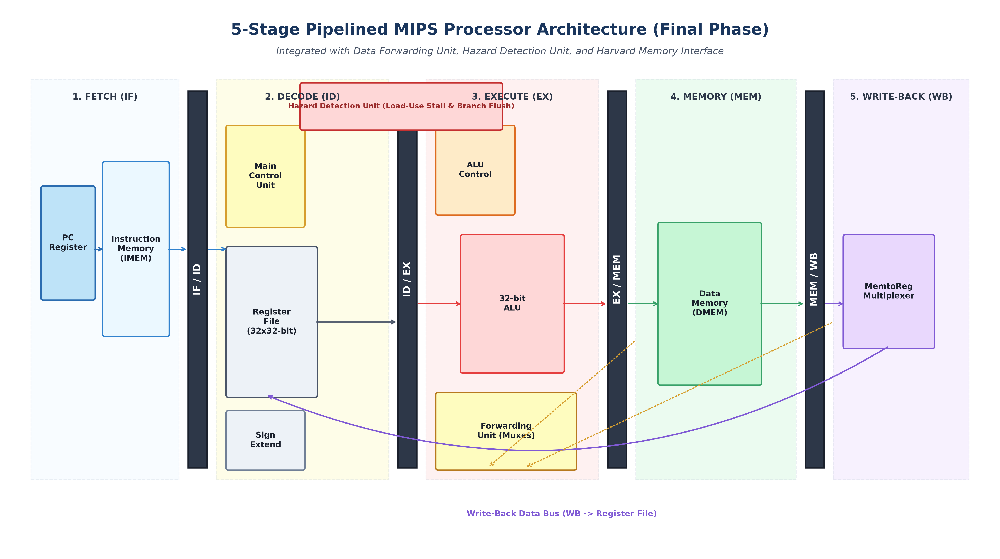

# Single-Cycle & 5-Stage Pipelined MIPS Processor with Memory Interface and Hazard Resolution


-brightgreen.svg)

-purple.svg)

A complete, fully verified, synthesizable 32-bit RISC microprocessor project delivering both a **Single-Cycle MIPS processor** and a high-performance **5-Stage Pipelined MIPS processor** with a Harvard memory subsystem, dedicated Data Forwarding Unit, and Hazard Detection Unit in Verilog HDL. Developed as a 5-member university group project for Final Phase evaluation (100% full project defense).

---

## Architecture Overview

The project provides two complete, cycle-accurate processor architectures:

1. **Baseline Single-Cycle Core (`src/mips_cpu.v`):** Monolithic datapath executing each instruction in one clock cycle ($CPI = 1.0$), with a critical path delay of ~18.1 ns (~55 MHz max frequency on Artix-7).
2. **5-Stage Pipelined Core (`src/pipelined/pipelined_mips_cpu.v`):** Classic RISC pipeline (IF, ID, EX, MEM, WB) operating at ~185 MHz with an effective CPI of ~1.18, achieving a **~2.85x overall throughput speedup**.



### Key Architectural Highlights
- **32-Bit Datapath:** Uniform 32-bit data buses, registers, ALU, and memory interfaces.
- **32 General-Purpose Registers:** Register `$zero` (`$0`) is permanently hardwired to `32'h00000000` with hardware write protection.
- **5-Stage Pipelining:** Synchronous pipeline registers (IF/ID, ID/EX, EX/MEM, MEM/WB).
- **Data Forwarding Unit:** Resolves EX and MEM Read-After-Write (RAW) data hazards with **zero stall penalty**.
- **Hazard Detection Unit:** Identifies Load-Use data hazards, inserting a 1-cycle stall bubble, and flushes misfetched instructions upon branch/jump events.
- **Harvard Memory Interface:** Separate 256-word (1024-byte) Instruction ROM and 256-word Data RAM with 32-bit word-aligned addressing.
- **100% Automated Self-Checking Verification:** 78 assertions executed across 6 testbenches with 0 failures.
- **5 Verified Benchmarks:** Array Sum (100), Maximum Search (67), Factorial (120), Fibonacci Sequence (21), and Bubble Sort.

---

## Supported Instruction Set Architecture (ISA)

| Instruction | Type | Opcode | Funct | Semantics |
|-------------|:----:|:------:|:-----:|-----------|
| **ADD** | R | `000000` | `100000` | $R[rd] \leftarrow R[rs] + R[rt]$ |
| **SUB** | R | `000000` | `100010` | $R[rd] \leftarrow R[rs] - R[rt]$ |
| **AND** | R | `000000` | `100100` | $R[rd] \leftarrow R[rs] \ \& \ R[rt]$ |
| **OR** | R | `000000` | `100101` | $R[rd] \leftarrow R[rs] \ \| \ R[rt]$ |
| **SLT** | R | `000000` | `101010` | $R[rd] \leftarrow (R[rs] <_{\text{signed}} R[rt]) \ ? \ 1 : 0$ |
| **ADDI** | I | `001000` | — | $R[rt] \leftarrow R[rs] + \text{SignExt}(imm)$ |
| **LW** | I | `100011` | — | $R[rt] \leftarrow \text{Mem}[R[rs] + \text{SignExt}(offset)]$ |
| **SW** | I | `101011` | — | $\text{Mem}[R[rs] + \text{SignExt}(offset)] \leftarrow R[rt]$ |
| **BEQ** | I | `000100` | — | $\text{if } R[rs] == R[rt] \implies \text{PC} \leftarrow (\text{PC}+4) + (\text{SignExt}(imm) \ll 2)$ |
| **J** | J | `000010` | — | $\text{PC} \leftarrow \{(\text{PC}+4)[31:28], target[25:0], 2'b00\}$ |

---

## Repository Structure

```
MCA_Project/
├── FINAL_COMPLETION_REPORT.md         # Formal Final Phase verification audit
├── PHASE1_COMPLETION_REPORT.md        # Phase I completion report
├── PROJECT_STATUS.md                  # Comprehensive project status tracker
├── README.md                          # Repository documentation
├── diagrams/                          # High-resolution architectural diagrams
│   ├── pipelined_architecture.png     # 5-Stage pipelined architecture diagram
│   ├── datapath_architecture.png      # Single-cycle datapath diagram
│   └── ...
├── docs/                              # Architectural documentation
├── presentation/                      # Defense presentations and scripts
│   ├── final_presentation.pptx        # 14-slide widescreen presentation deck
│   ├── FINAL_PRESENTATION_SCRIPT.md   # Word-for-word spoken script for 4 teammates
│   ├── Final_Presentation_Script_4_Teammates.pdf # Formatted printable script PDF
│   └── generate_final_presentation.py # Slide deck generator script
├── programs/                          # Assembly source and hex files
│   ├── array_sum.asm / .hex           # Benchmark 1: Sum 10,20,30,40 -> 100
│   ├── maximum_search.asm / .hex      # Benchmark 2: Max 12,45,23,67,34 -> 67
│   ├── factorial.asm / .hex           # Benchmark 3: 5! = 120
│   ├── fibonacci.asm / .hex           # Benchmark 4: F(0..8) -> F(8) = 21
│   ├── bubble_sort.asm / .hex         # Benchmark 5: Sort [45,12,89,34,23]
│   └── assemble.py                    # Cross-assembler for all benchmarks
├── report/                            # IEEE Project Reports
│   ├── final_project_report.pdf       # Final Phase IEEE Project Report (PDF)
│   ├── project_report.tex             # LaTeX source code
│   └── generate_final_report.py       # PDF report generator script
├── simulation/                        # Waveforms and regression logs
│   ├── results/                       # Testbench output logs
│   └── waveforms/                     # VCD dumpfiles and GTKWave savefiles
│       └── mips_demo.gtkw             # Pre-configured GTKWave signal layout
├── src/                               # Baseline Single-Cycle Verilog RTL
│   ├── alu.v, control_unit.v, ...
│   └── pipelined/                     # 5-Stage Pipelined Verilog RTL
│       ├── forwarding_unit.v          # Data Forwarding Unit
│       ├── hazard_detection_unit.v    # Load-Use & Branch Hazard Unit
│       ├── pipe_if_id.v               # IF/ID Register
│       ├── pipe_id_ex.v               # ID/EX Register
│       ├── pipe_ex_mem.v              # EX/MEM Register
│       ├── pipe_mem_wb.v              # MEM/WB Register
│       ├── pipelined_mips_cpu.v       # 5-Stage Pipelined CPU Core
│       └── top_pipelined_module.v     # Top wrapper
└── testbench/                         # Self-checking automated testbenches
    ├── tb_alu.v, tb_control_unit.v, ...
    ├── tb_mips_cpu.v                  # Single-Cycle System Testbench (24/24 PASS)
    └── tb_pipelined_mips.v            # Pipelined System Testbench (21/21 PASS)
```

---

## Quick-Start: Build, Simulate & Verify

### 1. Run Complete Automated Regression Suite
```bash
# Compile and run all 6 self-checking testbenches:
iverilog -g2001 -o simulation/tb_alu src/alu.v testbench/tb_alu.v && vvp simulation/tb_alu
iverilog -g2001 -o simulation/tb_control_unit src/control_unit.v testbench/tb_control_unit.v && vvp simulation/tb_control_unit
iverilog -g2001 -o simulation/tb_register_file src/register_file.v testbench/tb_register_file.v && vvp simulation/tb_register_file
iverilog -g2001 -o simulation/tb_data_memory src/data_memory.v testbench/tb_data_memory.v && vvp simulation/tb_data_memory
iverilog -g2001 -o simulation/tb_mips_cpu src/*.v testbench/tb_mips_cpu.v && vvp simulation/tb_mips_cpu
iverilog -g2001 -o simulation/tb_pipelined_mips src/*.v src/pipelined/*.v testbench/tb_pipelined_mips.v && vvp simulation/tb_pipelined_mips
```

### 2. Inspect Waveforms in GTKWave
```bash
# Launch GTKWave with pre-configured signal hierarchy:
gtkwave simulation/waveforms/tb_mips_cpu.vcd simulation/waveforms/mips_demo.gtkw
```

### 3. Re-assemble Benchmark Programs
```bash
python3 programs/assemble.py
```

---

## Team Contributions & Work Allocation

| Team Member | Role | Core Technical Ownership |
| :--- | :--- | :--- |
| **Member 1** | CPU Architecture & Integration Lead | Program Counter, Instruction ROM, Top wrappers, Pipelined CPU core |
| **Member 2** | ALU & Register File Specialist | 32-bit ALU, ALU Control Decoder, Register File with `$zero` protection, Forwarding Multiplexers |
| **Member 3** | Control Unit & Hazard Detection Specialist | Main Control Unit, Sign Extension, Hazard Detection Unit |
| **Member 4** | Memory Subsystem & Verification Lead | Data RAM, Self-Checking Testbenches, Assembly Benchmarks, Waveform analysis |
| **Member 5** | Technical Documentation & Presentation Lead | IEEE Technical Reports, Presentation Slides, Architecture Diagrams, Repository Management |

---

## License
This project is licensed under the MIT License - see the [LICENSE](LICENSE) file for details.
